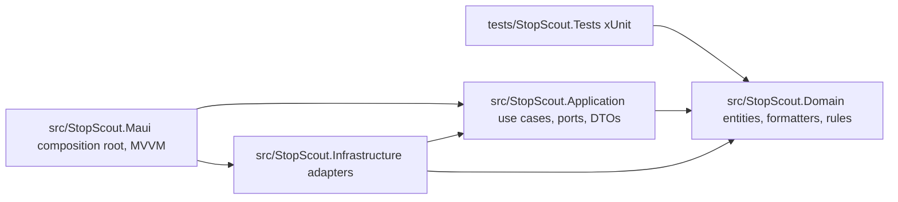

# Stop Scout

**PL:** Stop Scout pokazuje żywe odjazdy komunikacji miejskiej w Gdańsku (otwarte dane ZTM). Aplikacja jest projektowana jako offline-first, do pracy w terenie.

**EN:** Stop Scout shows live public-transport arrivals for Gdańsk using ZTM open data. It is designed to stay usable in the field with poor network.

Current build: mock departures for stop **2072 / Dworzec Główny**, domain formatters, `DepartureCard` and a pulsing `DelayHighlightView`. Live HTTP, SQLite, map and accounts are not wired yet.

---

## Run

Requires [.NET 10 SDK](https://dotnet.microsoft.com/) and the MAUI Android workload (`dotnet workload install maui`).

```bash
dotnet workload restore
dotnet build StopScout.sln
dotnet test
dotnet build src/StopScout.Maui/StopScout.Maui.csproj -f net10.0-android
```

Deploy to an Android emulator (example AVD `pixel_7_-_api_36_0`):

```bash
dotnet build src/StopScout.Maui/StopScout.Maui.csproj -f net10.0-android -t:Run
```

Windows MAUI (`net10.0-windows10.0.19041.0`) is included. iOS / Mac Catalyst TFMs can be added on a Mac.

`ApplicationId`: `pl.edu.pg.student.stopscout`.

---

## Architecture



- **Domain** references nothing beyond the BCL. Formatters have no `Microsoft.Maui` usings.
- **Application** references Domain. Ports and use cases (`GetLiveDeparturesUseCase`, …).
- **Infrastructure** implements ports. The running app uses `MockDepartureFeed`.
- **MAUI** is the composition root (`MauiProgram.cs`). Views bind to ViewModels; ViewModels take use cases.
- **Tests** reference Domain (formatter rules).

---

## Current UI

- Tab **Odjazdy**: stop 2072, departures with on-time / `+90s` / major delay pulse.
- Trips that left more than 2 minutes ago are hidden; under 2 minutes stay as **odjechał**.
- TRISTAR `10177` is shown as **177**.
- **Odśwież** / **Symuluj błąd** for loading, list, and error states.
- **Mapa** and **Konto** are placeholders.

---

## Not wired yet

| Area | Where it will live |
| --- | --- |
| ZTM HTTP client | `IZtmDeparturesClient`, `ZtmEndpoints` |
| SQLite cache / accounts / favourites | `IStopCatalog`, `IUserStore`, `IFavoriteStore` |
| Password hashing | `IPasswordHasher` |
| Optimistic favourites | `IFavoritesSession` |
| Registration / login | `AccountPlaceholderPage`, `RegisterUserUseCase`, `LoginUserUseCase` |
| Map (WebView + OpenStreetMap) | `MapPlaceholderPage` |
| Use-case tests with a frozen clock | `StopScout.Tests` |

---

## Screenshots

ZIP **without** `bin` / `obj` + emulator shots in [`docs/screenshots/`](docs/screenshots/).

- [`m1-departures-light.png`](docs/screenshots/m1-departures-light.png)
- [`m1-departures-dark.png`](docs/screenshots/m1-departures-dark.png)
- [`m1-error.png`](docs/screenshots/m1-error.png)
- [`m1-map-placeholder.png`](docs/screenshots/m1-map-placeholder.png)
- [`m1-account-placeholder.png`](docs/screenshots/m1-account-placeholder.png)

```bash
dotnet build StopScout.sln
dotnet test
```
