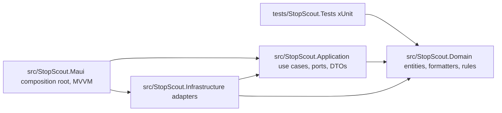

# Stop Scout

**PL:** Stop Scout pokazuje żywe odjazdy komunikacji miejskiej w Gdańsku (otwarte dane ZTM). Aplikacja jest offline-first i przeznaczona do pracy w terenie.

**EN:** Stop Scout shows live public-transport arrivals for Gdańsk using ZTM open data. It is designed to stay usable in the field with poor network.

This tree is **Milestone 1** only: Clean Architecture skeleton, mock departures for stop **2072 / Dworzec Główny**, `RouteFormatter` / `DelayFormatter`, `DepartureCard` + pulsing `DelayHighlight`. No real HTTP, SQLite, map, login, or APK publish.

---

## Run

Requires [.NET 10 SDK](https://dotnet.microsoft.com/) and the MAUI Android workload (installed with Visual Studio 2026 / `dotnet workload install maui`).

```bash
dotnet workload restore
dotnet build StopScout.sln
dotnet test
dotnet build src/StopScout.Maui/StopScout.Maui.csproj -f net10.0-android
```

Deploy to an Android emulator (example AVD `pixel_7_-_api_36_0`):

```bash
dotnet build src/StopScout.Maui/StopScout.Maui.csproj -f net10.0-android -t:Run
```

Windows MAUI (`net10.0-windows10.0.19041.0`) is included in the same project. iOS / Mac Catalyst TFMs are omitted on this Windows machine; add `net10.0-ios` / `net10.0-maccatalyst` later if you have a Mac.

ApplicationId placeholder (Milestone 3 will become `pl.edu.pg.student.<index>.stopscout`): `pl.edu.pg.student.stopscout`.

---

## Architecture



- **Domain** references nothing (BCL only). Formatters have zero `Microsoft.Maui` usings.
- **Application** references Domain. Ports (`IDepartureFeed`, `IClock`, …) and `GetLiveDeparturesUseCase`.
- **Infrastructure** implements ports. Milestone 1 uses `MockDepartureFeed`.
- **MAUI** is the composition root (`MauiProgram.cs`). Views bind to ViewModels; ViewModels take use cases — no `HttpClient` in a ViewModel.
- **Tests** reference Domain only in Milestone 1.

---

## Stack mapping

| Original brief | This solution |
| --- | --- |
| Expo / React Native | .NET MAUI (`net10.0-android`) |
| TypeScript | C# |
| Zustand | ViewModels (`CommunityToolkit.Mvvm`) + application services |
| FlatList | `CollectionView` |
| Typed `DepartureCard` | `ContentView` `DepartureCard` |
| `Animated` + native driver | MAUI `Animation` opacity pulse on `DelayHighlight` |
| `delayFormatter` / `routeFormatter` | `StopScout.Domain.Formatting` |
| Jest | xUnit (`StopScout.Tests`) |
| `app.json` / EAS / APK | Milestone 3: `dotnet publish` + unique `ApplicationId` |

---

## Milestone 1 behaviour

- Tab **Odjazdy**: mock stop 2072, list of departures (on time, minor `+90s`, major `+3 min` / `+4 min` with pulse).
- Trip that left **more than 2 minutes ago** is filtered out (`DepartureVisibilityRule` + `IClock`).
- Trip that left **under 2 minutes ago** stays (`odjechał`).
- TRISTAR `10177` is shown as **177**.
- **Odśwież** / **Symuluj błąd** for loading, list, and error states.
- Tabs **Mapa** (Milestone 3) and **Konto** (Milestone 2) are placeholders.

---

## Intentionally stubbed (Milestones 2 and 3)

| Item | Milestone | Location |
| --- | --- | --- |
| Real ZTM `HttpClient` | 2 | `IZtmDeparturesClient`, `ZtmEndpoints`, `NotImplementedZtmDeparturesClient` |
| SQLite cache / accounts / favourites | 2 | `IStopCatalog` (mock now), `IUserStore`, `IFavoriteStore` |
| BCrypt password hashing | 2 | `IPasswordHasher` |
| Optimistic favourites UI | 2 | `IFavoritesSession` |
| Registration / login screens | 2 | `AccountPlaceholderPage` |
| Map pins, bounding box, GPS | 3 | `ILocationService`, `MapPlaceholderPage` |
| `GetLiveDeparturesUseCase` tests with frozen clock | 3 | Test project exists; only formatters are covered now |
| Unique `ApplicationId` + release APK | 3 | Placeholder id only |

---

## Verification (Milestone 1)

Original lab: ZIP without `node_modules` + Expo Go screenshots.

Here: ZIP **without** `bin` / `obj` + emulator screenshots in [`docs/screenshots/`](docs/screenshots/).

- [`m1-departures-light.png`](docs/screenshots/m1-departures-light.png) — list with on-time / `+90s` / pulsing major delay; TRISTAR `177`; stale trip absent
- [`m1-departures-dark.png`](docs/screenshots/m1-departures-dark.png)
- [`m1-error.png`](docs/screenshots/m1-error.png) — **Symuluj błąd**
- [`m1-map-placeholder.png`](docs/screenshots/m1-map-placeholder.png) — Milestone 3
- [`m1-account-placeholder.png`](docs/screenshots/m1-account-placeholder.png) — Milestone 2

```bash
dotnet build StopScout.sln
dotnet test
```
